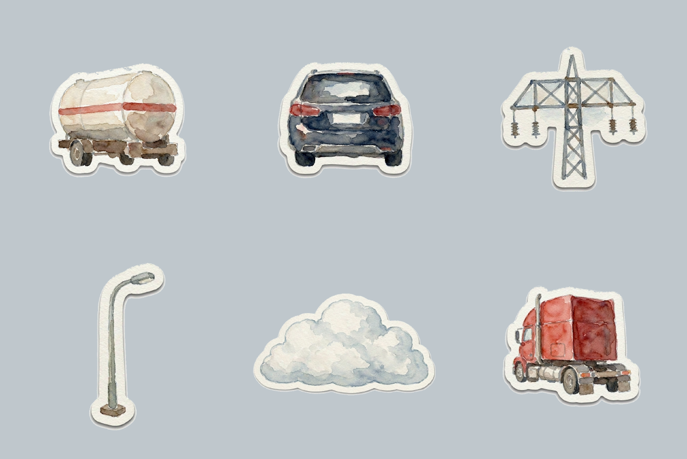

# 水彩贴纸套件 · watercolor-sticker-kit

一张照片 → 一套可以到处贴的水彩贴纸。

从照片里挑出有轮廓的实物，一枚一枚做成**独立 PNG**：水彩晕染、纸白高光、暖白手剪留边、极淡投影、背景真透明。



<sub>示例：从一张公路照片提取出罐车、SUV、输电塔、路灯、积云、卡车头六枚贴纸。全部透明底 PNG。</sub>

## 为什么不在一张图里画完

图像模型数不准数量。要求它「在一张图里画六枚贴纸」，它会稳定少画一两枚，还会把它们排得歪歪扭扭。这个技能反过来做：**每枚单独一张图，最后不拼版**。数量永远准确，每枚也能单独用。

## 怎么用

```
把这张照片里的东西做成水彩贴纸
```

它会先列出要做的元素清单（4–6 枚，标好主次和取色），生成第一枚给你看。风格对味了再说「继续」，它批量出剩下的。

也可以直接指定：

- 「只做那辆罐车和输电塔」
- 「全部做成小号配件贴纸」
- 「加水彩，但保留原照片的配色」

## 结构

```
watercolor-sticker-kit/
├── SKILL.md                        # 三条铁律、规格、元素怎么挑、流程、检查清单
├── references/
│   ├── watercolor-spec.md          # 三层明度 / 水彩特征 / 手剪白边 / 投影 / 两步抠透明
│   └── prompt-recipes.md           # S-1 单枚模板、S-2 风格锚定、S-3/S-4 纠偏、失败模式表
├── scripts/
│   ├── matte.py                    # 零依赖白底转透明，2.6 秒 / 张
│   └── sheet.py                    # 零依赖拼预览页，多枚一次看全
├── preview/
│   └── sticker-sheet.png           # 示例成品
├── README.md
└── LICENSE
```

## 安装

把整个仓库放进技能目录即可：

```bash
git clone https://github.com/Jin-xu13/watercolor-sticker-kit.git \
  ~/.workbuddy/skills/watercolor-sticker-kit
```

重启后即可用自然语言触发。

## 已知陷阱

**白色主体不要做风格锚定。** 画云团时把白色罐车当 `image2` 传进去，模型直接抄了罐子形体，出来一辆小白罐车。锚定图与被画对象明度越近，内容泄漏越重。

## 两条硬规则

1. **一次一枚，不做拼版** —— 数量准确优先。
2. **透明靠抠，不信模型** —— 图像工具不出 alpha 通道，一律先生成纯白底再跑 `scripts/matte.py`。

## 依赖

只需要 Python 3，**不需要 Pillow / numpy**。`scripts/matte.py` 是纯标准库实现：自己解 PNG、从四边洪水填充、写回 RGBA。很多环境装不上第三方库，所以故意做成零依赖。

## 不适合做什么

天空、路面、水面这类没有轮廓的面，做出来只是一块脏色斑。人脸不行，水彩画脸必崩。带字的招牌车牌不行，字一定糊。

## 许可

MIT，见 LICENSE。可自由使用、修改、分发。
